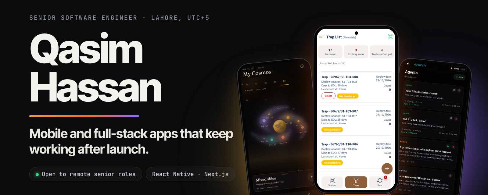
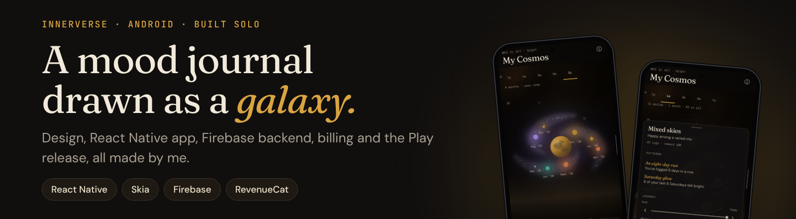
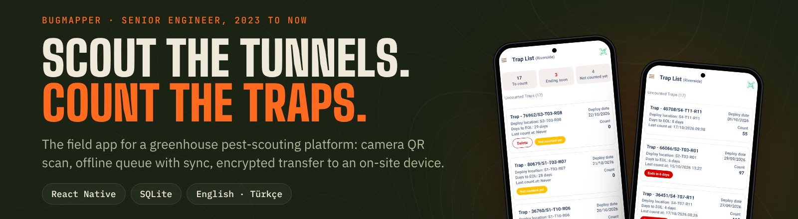
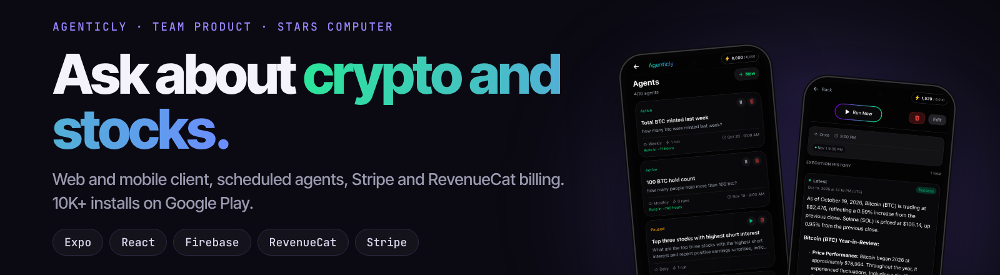
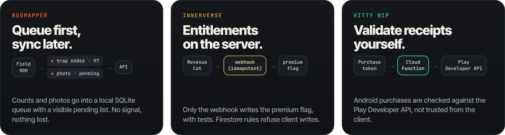
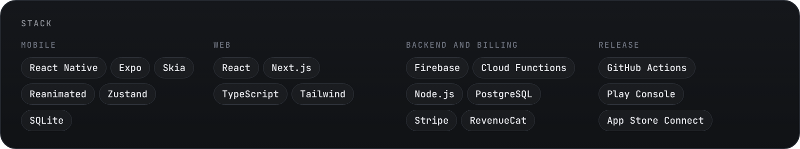

  

  <a href="https://qasimjaffry.github.io/qasim-portfolio/"><b>Portfolio</b></a> &nbsp;·&nbsp;
  <a href="https://linkedin.com/in/qasim-hassan-02871a171"><b>LinkedIn</b></a> &nbsp;·&nbsp;
  <a href="https://www.upwork.com/freelancers/~011828438344ce4299"><b>Upwork</b></a> &nbsp;·&nbsp;
  <a href="mailto:qhassan1214@gmail.com"><b>qhassan1214@gmail.com</b></a>

I build the parts of mobile and web apps that have to keep working after launch: offline sync, subscriptions, sign-in, store receipts and the release pipeline around them. React Native / Expo and React / Next.js, with Firebase, Stripe and RevenueCat behind them. About six years, based in Lahore, open to remote senior roles.

## Shipped

**Innerverse.** Every entry becomes a world on a galaxy map drawn with Skia. Design, app, Firebase backend, billing and the Play release are all mine. &nbsp;[Google Play](https://play.google.com/store/apps/details?id=innerverse.app) · [innerverse.app](https://innerverse.app)

 

**BugMapper.** Greenhouse staff scan a trap's QR code with the camera, record the count and move on. Counts and photos queue in SQLite and sync when the signal returns; files go to an on-site device over an encrypted transfer. English and Turkish. &nbsp;[bugmapper.com.tr](https://bugmapper.com.tr/)

 

**Agenticly.** Web and mobile client, scheduled agents, Stripe and RevenueCat billing. Built with the team at Stars Computer. &nbsp;[Google Play](https://play.google.com/store/apps/details?id=computer.star.agenticly) · [App Store](https://apps.apple.com/us/app/agenticly-stock-crypto-ai/id6760048191) · [web](https://agenticly.app)

### More

| Product | What I did | Check it |
|---|---|---|
| **Kitty Nip** | Mobile engineer on a live React Native app: upgrades, sign-in, subscriptions, receipt validation in Cloud Functions | [App Store](https://apps.apple.com/us/app/kitty-nip-cat-dating-app/id1520805359) · [Google Play](https://play.google.com/store/apps/details?id=computer.star.kittynip) 10K+ |
| **Safe Deal** | The WebView shopping browser: link handling, loop protection, Zustand state | [Google Play](https://play.google.com/store/apps/details?id=com.safedeal.navigator) 5K+ |
| **Bschedule** (2021 to 2022) | Staff and customer scheduling apps on one API, React Native | Private client tool, apps no longer on the stores |
| **Decidr** | Weighted decision matrices with Stripe. Personal SaaS | [source](https://github.com/QasimJaffry/Decidr) · [live](https://decidr-henna.vercel.app/) |

Client source stays private, so most entries link to the live product instead.

## How I build

Usually asked to fix: subscriptions that grant or revoke access wrongly across Stripe, RevenueCat, Apple and Google; offline apps that lose or duplicate data on reconnect; auth flows that break on one platform only; React Native upgrades on apps that started as class components.

